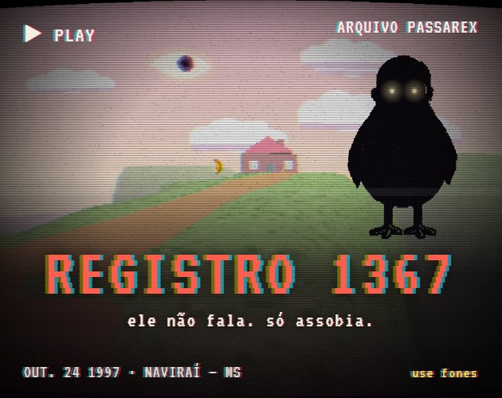

# 📼 Registro 1367 · Arquivo Passarex

Um jogo curto de terror **dreamcore** em primeira pessoa, no estilo PS1 e fita VHS. *Ele não fala. Só assobia.*

🔗 **Página:** https://odavyyy.github.io/registro-1367/
▶️ **Jogar:** https://odavyyy.itch.io/registro-1367
🎬 **Trailer:** https://youtu.be/6tqPn_Aw5b8
📸 **Instagram:** https://www.instagram.com/odavyyy1/

> 📼 **O jogo recebe atualizações sempre que possível.** A mais nova (v1.4) trouxe o centro de Naviraí, a missão do Mago e do Macaco e a luta contra o Passarex. Veja a lista em [Atualizações](#atualizações).

## Atualizações

### v1.7 · Os Portões do Clubex (23/11/2026)
- Final no céu: um hino te leva aos Portões do Clubex; o Homem-Distinto te recebe e lá dentro fica o salão dos segredos (elenco, história, 67, Bacanos, jukebox)
- Floresta de cogumelos com o Mago, o Macaco, o Pássaro das Esferas e o Pássaro Cocô
- Caixa de diálogo e conversas novas contando a lore
- Serjão assando espeto (só se pedir), o padre na catedral (comunhão ou bênção, com respeito) e o fliperama PEGA A RATABRUMGA!
- Moedas, 19 conquistas, skins e roupas, e câmera em 3ª pessoa (tecla V)
- Rádio com "Portões Abertos do Clubex" · letreiro do IF corrigido

### v1.6 · A luta caprichada, a catedral e o patinete (23/11/2026)
- Luta do Passarex com bicadas, leque de penas, passarinhos e o giro nas asas, em 3 fases
- Parry nas penas rosas, cartas de especial (Goiaba EX e SUPER GOIABADA), goiabas douradas de vida e nota no fim
- Catedral entrável com o sacrário, feita com respeito (sem susto lá dentro)
- Patinete elétrico e montar no Cachorro Orelha
- IF mais detalhado (alas, marquise, bandeiras, bicicletário, portaria)
- A conveniência agora é Pobresa · correção das texturas piscando

### v1.5 · Repetir fases e Rádio Clubex FM (23/11/2026)
- **Menu FASES**: as fases que você termina ficam liberadas pra jogar de novo (sem mexer no save)
- **Rádio Clubex FM** com as músicas do Suno pelo player do Suno (menu, pausa e o rádio da Pobresa). Primeira faixa: "O Davy escorregou", do oDavyyy

### v1.4 · O centro de Naviraí e a luta (23/11/2026)
- **Nova fase: o centro de Naviraí**, com a praça (coreto e catedral), a Pobresa Conveniência e o IFMS Campus Naviraí. Ache o Passarex escondido nos três
- **Missão do Mago e do Macaco**: goiabas doces com o Pássaro das Esferas (peça!) e azedas com o Pássaro Cocô (ele quer um refri gelado). O Macaco monta as máquinas de goiaba
- **Luta 2D contra o Passarex**, estilo desenho antigo, com ataques de penas em padrões
- **Depois da luta**: cidade destruída, leve o café de Naviraí pra polícia fazer o soro antes que ele acorde
- Rádio Clubex FM (músicas do Suno na próxima atualização) e vozes novas

### v1.3 · 1491 e o Plantão no Clubex (23/11/2026)
- **Nova fase: Registro 1491.** Um navio no oceano: o Douradex aponta ("É por ali, confia!"), o Colombo duvida, o Tonho te dá o leme. Siga o fiu fiu e descubra as Américas um ano antes de Colombo
- **Nova fase: a sala branca**, com um joguinho no PC: **Plantão no Clubex**. Vigie portas e câmeras do QG até as 6h
- **12 segredos do Clubex** escondidos pelo jogo (a tela final mostra quantos você achou)
- Vozes novas para o Douradex, o Colombo, o Tonho e o narrador

### v1.2 · A avenida e os finais (23/11/2026)
- **Nova fase: a avenida de Naviraí.** Lojas fechadas, postes, a locadora com TVs na vitrine e a sua casa no fim da rua. Fim de tarde ou quase meia-noite, conforme a porta escolhida
- **Um orelhão que toca.** Do outro lado da linha, uma voz conhecida
- **A página de colorir:** uma folhinha na escola para pintar com o mouse ou com o dedo. Pense bem antes de pintar os olhos
- **Os três finais:** Fita ejetada, Conexão perdida e o secreto, Registro 1368. A tela final mostra quantos você já encontrou
- 3 pistas para achar, 12 vozes novas, e ele agora aparece debaixo dos postes
- Correção: a tela não fica mais com falha depois da porta vermelha

### v1.1 · Menu, opções e trilha sonora (23/11/2026)
- Menu principal novo (Continuar, Novo jogo, Opções, Como jogar, Créditos, trailer)
- Opções: volume, música, música do menu liga/desliga, legendas, sensibilidade da câmera, tela cheia
- Pausa com botões (Continuar, Opções, Menu principal)
- Sons gravados pelo oDavyy: "fiu fiu", grito dos sustos, música do menu e trilha sonora em loop o jogo inteiro
- Botões grandes para as escolhas no celular · correção dos textos tortos no começo

### v1.0 · Lançamento (22/11/2026)
- A sala de casa, as colinas, as salas amarelas e a sala de brincar
- Vozes, sustos, falhas de tela, a fuga e a dica com o passarinho guia
- PC e celular · save automático

## O que é
Um protótipo de jogo do **Arquivo Passarex**, inspirado na lore d'**Os Bacanos**. Você assiste a uma fita do "Canal dos Passarinhos" e é puxado para dentro dela: colinas de sonho com uma casinha rosa, salas amarelas no estilo backrooms, uma sala de brincar com oito portas e a avenida de Naviraí, com uma escola e uma folhinha para pintar. São 10 a 15 minutos, com escolhas, pistas, uma fuga e alguns sustos. Funciona no PC e no celular.

## Como a gente fez
Feito por **oDavyy** com o **Claude Code** (Anthropic): o Davy dirigia (referências, clima, feedback) e o Claude planejava, programava, testava e ajustava. Este repositório tem **só a página de bastidores**. O código do jogo não é publicado.

- Visual PS1 + VHS: render em 320×240, vértices tremendo, névoa e filtro de TV de tubo
- O Passarex é o desenho 2D original da série, como figurinha dentro do mundo 3D
- Vozes geradas localmente no VoiceStudio (Passarex de criança com rádio e falhas, e um narrador de arquivo)
- Sons sintetizados na hora pelo navegador
- Dica com um passarinho guia, controles de toque e publicação no itch.io

## Finais possíveis
Um contador escondido, **"ele te notou"**, junto com as 3 pistas e as 3 penas que você acha, decide como a fita termina.

<b>Ver os finais (spoiler)</b>

**O caminho:**
- A porta da sala de brincar define Naviraí: **fim de tarde** (praia, escada, campo) ou **quase meia-noite** (navio, rua, quarto). A porta vermelha não deixa passar, e uma delas só dá numa parede.
- Na avenida, um orelhão toca. A folhinha de colorir está na escola. **Pintar os olhos dele conta como ele te notar.**
- Pistas: o recorte de jornal na gaveta, a página do diário no navio e a folhinha da escola. Penas: nas salas amarelas.

**Os três finais:**
- **A · Fita ejetada:** o mais comum. Você acorda no sofá, a fita sai sozinha e, lá longe, um "fiu fiu".
- **B · Conexão perdida:** ele te notou 3 vezes ou mais. A luz apaga e ele aparece na sua frente, dentro de casa.
- **C · Registro 1368 (secreto):** as 3 pistas, as 3 penas e no máximo 1 vez notado. A câmera agora está do lado de fora da sua janela.

## Save
O jogo salva sozinho a cada lugar novo, pista e pena. Dá para **continuar** de onde parou, e se ele te pegar na fuga você volta do ponto onde ela começou. O save fica só no navegador de quem joga.

## Créditos e direitos
**Passarex, o Arquivo Passarex, os personagens e a lore pertencem a Os Bacanos ([@os_bacanos67](https://www.instagram.com/os_bacanos67/)).** Todos os direitos reservados. Projeto de fã, sem fins lucrativos.

Feito por [oDavyy](https://www.instagram.com/odavyyy1/) com Claude Code. Veja também: [Passarex · Fiu Fiu, 1491](https://github.com/odavyyy/passarex) · [Elenco do Clubex](https://github.com/odavyyy/elenco-clubex)
